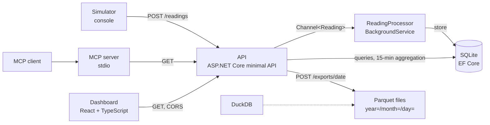

# MeterFlow

[](https://github.com/mjgromek/meterflow/actions/workflows/ci.yml)

An energy-metering pipeline in C# on .NET 11. Simulated meters send a reading every 5 minutes;
the API validates and queues them, a background service stores them in SQLite, and the data
is served as 15-minute consumption over REST, exported to Parquet, and exposed to AI agents
through a read-only MCP server and a React dashboard. All data is synthetic.

## Architecture



| Project | Role |
|---|---|
| `src/MeterFlow.Domain` | `Ean`, `Reading`, validation, gap and duplicate checks, 15-minute aggregation. No packages. |
| `src/MeterFlow.Infrastructure` | EF Core SQLite store and migrations, Parquet export. |
| `src/MeterFlow.Api` | Minimal API, bounded channel, background processor. |
| `src/MeterFlow.Simulator` | Generates readings with a day/night profile and deliberate gaps and duplicates; writes CSV or posts to the API. |
| `src/MeterFlow.Mcp` | Read-only MCP server (`list_meters`, `get_consumption`, `find_gaps`) that calls the API. |
| `frontend` | React + TypeScript dashboard (Vite): per-quarter chart of a meter's day and a data-quality table. Types and client generated from the API's OpenAPI document. |
| `tests/` | xUnit tests; API tests run the whole app in-process with `WebApplicationFactory`. |

Dependencies point inward: Domain references nothing. Design decisions are recorded in
[docs/adr](docs/adr/README.md); time zone handling and the DST-day behaviour (92, 96 or 100
quarters per local day) are in [docs/time-zones.md](docs/time-zones.md).

## Build and test

Requires the .NET 11 SDK.

```sh
dotnet tool restore
dotnet build
dotnet test
```

## Run

**API** (listens on `http://localhost:5265`, creates `meterflow.db` and applies migrations on
startup). `Pipeline:QueueCapacity` (default 10,000; env `Pipeline__QueueCapacity`) bounds the
reading queue; a POST waits while it is full.

```sh
dotnet run --project src/MeterFlow.Api
```

**Simulator**: arguments are meters, days, and either `--api <url>` or a CSV path. Without
`--api`, the environment variable `MeterFlow__ApiBaseUrl` selects the API instead of CSV.

```sh
dotnet run --project src/MeterFlow.Simulator -- 3 2 --api http://localhost:5265
MeterFlow__ApiBaseUrl=http://localhost:5265 dotnet run --project src/MeterFlow.Simulator -- 3 2
dotnet run --project src/MeterFlow.Simulator -- 3 1 readings.csv
```

**Queries** (the simulator starts its series N days before today, so adjust the dates):

```sh
curl http://localhost:5265/meters
curl "http://localhost:5265/meters/999000000000000007/consumption?from=2026-11-15T00:00:00Z&to=2026-11-15T01:00:00Z"
curl "http://localhost:5265/gaps?from=2026-11-15T00:00:00Z&to=2026-11-16T00:00:00Z"
```

**Parquet export and DuckDB**: exports one Europe/Amsterdam local day to
`exports/year=YYYY/month=MM/day=DD/quarters.parquet`.

```sh
curl -X POST http://localhost:5265/exports/2026-11-15
duckdb -c "SELECT ean, day, count(*) AS quarters, sum(kwh) AS kwh
           FROM read_parquet('src/MeterFlow.Api/exports/**/*.parquet', hive_partitioning = true)
           GROUP BY ALL ORDER BY ean"
```

**MCP server** (needs the API running; base URL in `MeterFlow:ApiBaseUrl`, default
`http://localhost:5265`). Register it with Claude Code from the repository root:

```sh
claude mcp add meterflow -- dotnet run --project src/MeterFlow.Mcp
```

**Dashboard** (needs the API running on `http://localhost:5265`, which allows the
dashboard's origin `http://localhost:5173` through `Cors:FrontendOrigin` in the `http` launch
profile; another API address goes in `VITE_API_URL`). Requires Node.js LTS.

```sh
dotnet run --project src/MeterFlow.Api
cd frontend && npm ci && npm run dev
```

Open `http://localhost:5173`, pick a meter and a day. Quarters with fewer than three readings
and quarters with a rejected reading are highlighted in two colours; rejected wins when both apply. `npm test` runs the Vitest suite, `npm run build`
type-checks and bundles.

**OpenAPI contract**: `dotnet build` writes the API's OpenAPI document to
`frontend/openapi/MeterFlow.Api.json` (also served at `/openapi/v1.json`).
`npm run generate` turns it into `frontend/src/api/schema.d.ts`, which types every call made
through `openapi-fetch`. Both files are committed; CI regenerates them and fails if either
differs, so an API change that breaks the dashboard shows up as a type error.

**Docker** (API only; database and exports go to the `/data` volume):

```sh
docker build -t meterflow-api .
docker run -d -p 8080:8080 -v meterflow-data:/data meterflow-api
curl http://localhost:8080/health
```

The image runs as a non-root user. `ConnectionStrings__MeterFlow` and `Export__Root` override
the database and export paths.

## API

| Method | Path | Result |
|---|---|---|
| GET | `/health` | 200 |
| POST | `/readings` | Body: array of `{ean, moment, kwh}`. 202 with accepted count and per-item rejections (`BadFormat`, `InvalidEan`, `NegativeKwh`). Stored asynchronously. |
| GET | `/meters` | Each meter with reading count, first and last moment. |
| GET | `/meters/{ean}/consumption?from=&to=` | 15-minute kWh totals in `[from, to)`. |
| GET | `/gaps?from=&to=` | Missing 5-minute readings per meter, most gaps first. |
| GET | `/meters/{ean}/days/{yyyy-MM-dd}` | Every quarter of the local day (92, 96 or 100) with kWh and reading count, gap moments, stored rejections. |
| GET | `/quality/{yyyy-MM-dd}` | Gaps, rejections and duplicates per meter for the local day, most issues first. |
| GET | `/openapi/v1.json` | OpenAPI document. |
| POST | `/exports/{yyyy-MM-dd}` | Writes the local day's quarters to Parquet; returns path and row count. |

Moments need an explicit offset or `Z`; anything else is a 400.

## Continuous integration

GitHub Actions ([ci.yml](.github/workflows/ci.yml)) restores tools, builds with warnings as
errors and runs all tests on every push and pull request. A frontend job checks that the
committed OpenAPI document and generated TypeScript types are current, then runs the
dashboard tests and build.

